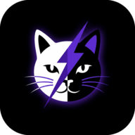

<div align="center">



# Cat Client

### اتصال، مدیریت و پنل شخصی — یکجا در اندروید

کلاینتی فارسی و متن‌باز بر پایه Mihomo، همراه با پنل Cloudflare، ابزارهای شبکه و رابط ساده برای استفاده روزمره.

<br>

<a href="https://github.com/mazodimobinhost-creator/cat-client/releases/download/v1.10.0-beta118/CatClient-V1.10.0-beta118-arm64-v8a.apk"><kbd>📥 دانلود برای بیشتر گوشی‌ها</kbd></a>
&nbsp;
<a href="https://github.com/mazodimobinhost-creator/cat-client/releases/download/v1.10.0-beta118/CatClient-V1.10.0-beta118-universal.apk"><kbd>📦 دانلود نسخه Universal</kbd></a>

<br><br>

<a href="https://github.com/mazodimobinhost-creator/cat-client/releases/tag/v1.10.0-beta118"><kbd>🐙 همه فایل‌های نسخه beta118</kbd></a>
&nbsp;
<a href="https://github.com/mazodimobinhost-creator/cat-client/issues/new"><kbd>💬 گزارش مشکل</kbd></a>

<br><br>

[](https://github.com/mazodimobinhost-creator/cat-client/actions/workflows/android.yml)
[](https://github.com/mazodimobinhost-creator/cat-client/actions/workflows/panel.yml)
[](LICENSE)

</div>

> [!IMPORTANT]
> `beta118` نسخه آزمایشی است؛ تست‌های خودکار موفق‌اند، اما تست گوشی فیزیکی و Cloudflare واقعی هنوز نهایی نشده‌اند.

## ✨ چه چیزهایی دارد؟

- ⚡ اتصال و مدیریت subscription با هسته Mihomo
- 📷 ورود و خروج QR برای جابه‌جایی سریع کانفیگ
- 🛰️ ابزارهای اسکن IP و بررسی مسیر اتصال
- ☁️ پنل شخصی Cloudflare با مدیریت کاربر و لینک‌های subscription
- 🎨 رابط فارسی و انگلیسی، RTL، تم روشن و تیره
- 🧩 خروجی‌های مناسب Mihomo، Xray و Sing-box
- 🧅 مسیرهای Orbot و dnstt در بخش‌های پیاده‌سازی‌شده
- 🔄 بررسی امن update، checksum، ABI و امضای APK
- 🚫 بدون Firebase و analytics اجباری

## ☁️ Cat Panel

Cat Panel یک Worker تک‌فایلی و phone-first است که پنل مدیریت، کاربران، subscriptionها، health و diagnostics را در اختیار مالک قرار می‌دهد.

<div align="center">

<a href="https://github.com/mazodimobinhost-creator/cat-client/releases/download/v1.10.0-beta118/catclient.worker.js"><kbd>📄 دریافت Worker</kbd></a>
&nbsp;
<a href="https://github.com/mazodimobinhost-creator/cat-client/releases/download/v1.10.0-beta118/catclient.wizard.js"><kbd>🧙 دریافت Wizard</kbd></a>
&nbsp;
<a href="docs/error-1101-fa.md"><kbd>🧯 راهنمای Error 1101</kbd></a>

</div>

### نصب امن

- نصب تازه فقط بعد از سه پاسخ سالم `/health` موفق اعلام می‌شود.
- data-plane در نصب تازه، بدون opt-in صریح مالک فعال نمی‌شود.
- Wizard برای محافظت از Secret، KV، D1 و bindingهای سفارشی، Worker موجود را overwrite نمی‌کند.
- Worker قابل استقرار یک ماژول عادی minified ESM است؛ artifact سنگین obfuscated دیگر deploy نمی‌شود.

> [!CAUTION]
> برای رفع `1101`، Worker یا KV را حذف نکنید. ابتدا Deployment قبلی و Live Logs را بررسی کنید.

## 🧪 وضعیت نسخه فعلی

- **App:** `1.10.0-beta118` · code `185`
- **Panel:** `6.68.0`
- **Wizard:** `1.3.1`
- **CI:** Android، JVM، Panel و UI tests موفق
- **در انتظار:** تست گوشی فیزیکی و deploy واقعی روی حساب Cloudflare

جزئیات تغییرات: [Release notes beta118](docs/release-notes-v1.10.0-beta118-draft.md)

<details>
<summary><strong>🛠️ ساخت و اجرای تست‌ها</strong></summary>

### نیازمندی‌ها

JDK 21، Android SDK 36، Build Tools 35، NDK 29، CMake 3.22.1، Go 1.24+ و Node.js 22.

```bash
./scripts/build-flclash-core.sh
./gradlew :app:compileDebugKotlin
./gradlew :app:testDebugUnitTest
./gradlew assembleDebug
```

```bash
npm install
npm test
node scripts/panels/wizard.test.mjs
node scripts/panels/abuse-safe-mode.test.mjs
```

</details>

<details>
<summary><strong>🔐 نکات امنیتی و گزارش خطا</strong></summary>

هنگام ارسال log، این موارد را حذف کنید:

```text
Authorization · Cookie · API Token · UUID · Password · Secret · subscription URL
```

برای خطای Worker، اولین exception، stack trace، deployment ID و request path مفیدند. Ray ID به‌تنهایی stack trace نیست.

- [راهنمای فارسی Error 1101](docs/error-1101-fa.md)
- [ایمنی استقرار پنل](docs/panel-deploy-safety.md)
- [برنامه تست گوشی](docs/beta113-device-test-plan.md)

</details>

## 🤝 مشارکت

Issue و Pull Request خوش‌آمدند. تغییرات باید کوچک، قابل تست و همراه با نتیجه واقعی باشند. UUID، KV، D1، Secret و history کاربر نباید بدون migration صریح reset شوند.

## 📄 مجوز

Cat Client تحت [GPL-3.0](LICENSE) منتشر شده است.

---

<div align="center">

### English summary

Cat Client is an open-source Android Mihomo client bundled with a Persian/English Cloudflare panel, subscription tools, network diagnostics, QR import/export, and fail-closed fresh deployment checks.

`beta118` is a test candidate. Automated tests pass; physical-device and real-account Cloudflare validation remain pending.

[Download](https://github.com/mazodimobinhost-creator/cat-client/releases/tag/v1.10.0-beta118) · [Report an issue](https://github.com/mazodimobinhost-creator/cat-client/issues/new) · [License](LICENSE)

</div>
